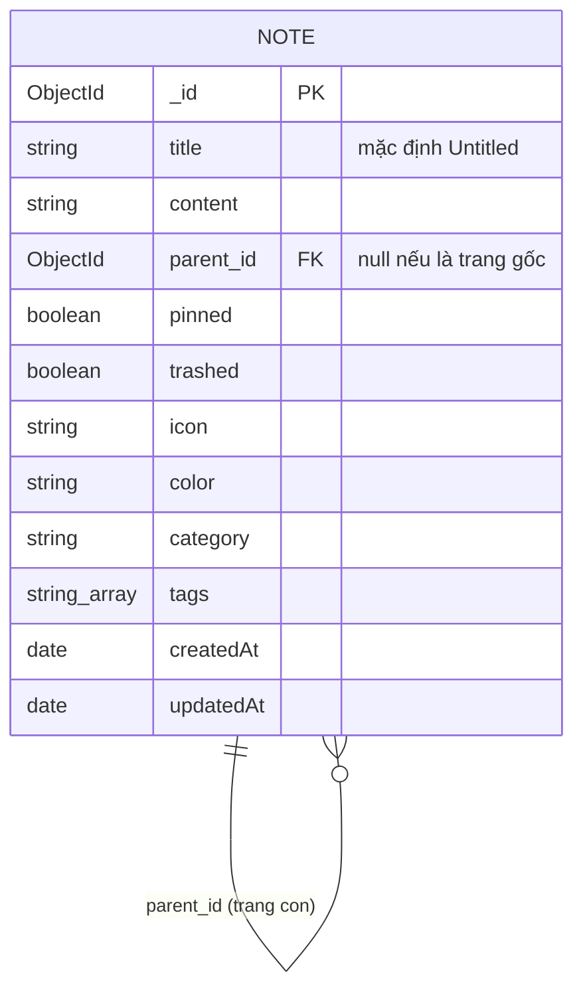

# NoteSpace

Ứng dụng ghi chú trực tuyến giúp người dùng tạo, chỉnh sửa, tìm kiếm, ghim và quản lý ghi chú, có trợ lý AI (Gemini) để tóm tắt, cải thiện văn phong và gợi ý tiêu đề. Dự án được phát triển cho học phần **CSB25022 – Web Design and Development** (VN-UK).

| | |
|---|---|
| **Frontend** | https://basic-web-note-frontend.vercel.app |
| **Backend API** | https://basic-web-note-backend.vercel.app/api |
| **Repository** | https://github.com/<tên-tài-khoản>/basic-web-note |
| **Video demo** | <!-- TODO: dán link YouTube (unlisted/public) --> |

## 1. Tổng quan và công cụ sử dụng

NoteSpace là ứng dụng web nhiều trang, giao diện lấy cảm hứng từ Notion (hỗ trợ chế độ sáng/tối). Frontend gọi REST API của backend; dữ liệu lưu trên MongoDB Atlas.

| Thành phần | Công nghệ |
|---|---|
| Frontend | HTML, JavaScript thuần, **Tailwind CSS** (CDN), Lucide Icons, font Inter |
| Backend | Node.js, Express 5 |
| Database | MongoDB Atlas, Mongoose |
| AI | Google Gemini API (`generateContent`), gọi từ backend |
| Hosting | Vercel (frontend và backend là hai project riêng) |
| Thiết kế / quản lý | Wireframe (`docs/`), Git và GitHub (branch, Issue, Pull Request) |

> **Về database:** brief nêu MySQL/PostgreSQL, nhóm sử dụng MongoDB Atlas và đã được giảng viên đồng ý.

## 2. Tính năng

### Ghi chú
- [x] Tạo, xem, sửa, xóa ghi chú (CRUD đầy đủ qua API và giao diện)
- [x] Trang soạn thảo với **tự động lưu** (hiển thị trạng thái Saving / Saved / Not saved) và lưu khi đóng tab
- [x] Đổi icon, gắn tags (nhập cách nhau bằng dấu phẩy)
- [x] Ghim / bỏ ghim, trang **Pinned** và mục Favorites trong sidebar
- [x] **Trash**: chuyển vào thùng rác, khôi phục, xóa vĩnh viễn (có hộp xác nhận), Empty Trash
- [x] Tìm kiếm theo tiêu đề, nội dung và tags

### AI Assistant (Gemini)
- [x] Tóm tắt ghi chú, cải thiện văn phong, gợi ý tiêu đề
- [x] Xem trước kết quả, chỉ áp dụng khi bấm **Apply**; có trạng thái loading và báo lỗi
- [x] API key chỉ nằm ở backend; tự chuyển sang model dự phòng khi model chính quá tải

### Giao diện và chất lượng
- [x] Giao diện sáng/tối, lưu lựa chọn trong trình duyệt
- [x] Responsive cho desktop, tablet và mobile (sidebar tự đóng trên màn hình nhỏ)
- [x] Trang Settings (đổi theme, kiểm tra kết nối API)
- [ ] Tối ưu Lighthouse (xem mục 6)
- [ ] Google Analytics và Sentry (xem mục 6)

### Chưa thực hiện
- Trang con (sub-page) và hiển thị phân cấp: schema đã có `parent_id` nhưng giao diện chưa hỗ trợ.
- Trình soạn thảo dạng block, slash commands.

### Ảnh chụp màn hình

<!-- TODO: chụp ảnh và lưu vào docs/screenshots/ với đúng tên dưới đây -->
| Home | Trang soạn note + AI |
|---|---|
|  |  |

| Pinned | Trash |
|---|---|
|  |  |

| Settings (chế độ tối) | Mobile |
|---|---|
|  |  |

## 3. Database (ERD)

Ứng dụng dùng một collection `notes`. Trường `parent_id` tham chiếu chính collection này để biểu diễn quan hệ trang cha – trang con.



Mã nguồn sơ đồ cho dbdiagram.io nằm tại [`docs/erd.dbml`](docs/erd.dbml).

**Seeder:** `backend/seeds/seed.js` nạp 8 ghi chú mẫu (có ghi chú đã ghim, ghi chú trong Trash, ghi chú có tags và một cặp cha – con). Xem cách chạy ở mục 4.

## 4. Hướng dẫn chạy

Yêu cầu: Node.js 20.19 trở lên và một database MongoDB (ví dụ MongoDB Atlas).

### Backend

```bash
cd backend
npm install
```

Tạo file `backend/.env` (tham khảo `backend/.env.example`):

```env
PORT=5000
MONGO_URI=mongodb+srv://<user>:<password>@<cluster>/notespace
GEMINI_API_KEY=<khóa lấy tại https://aistudio.google.com/apikey>
# Tùy chọn:
# GEMINI_MODEL=gemini-3.8-flash
# GEMINI_FALLBACK_MODELS=gemini-3.7-flash,gemini-3.5-flash-lite
```

Chạy server và (tùy chọn) nạp dữ liệu mẫu:

```bash
npm run dev                 # http://localhost:5000
npm run seed                # chỉ nạp khi database đang trống
npm run seed -- --reset     # XÓA toàn bộ ghi chú rồi nạp lại dữ liệu mẫu
```

Không commit `.env`, connection string hay API key lên GitHub.

### Frontend

Frontend là HTML/JavaScript thuần. Mở `frontend/index.html` bằng Live Server (VS Code) hoặc một static server bất kỳ. Mặc định frontend gọi backend production; để dùng backend local, đổi `API_BASE` trong `frontend/js/api.js` thành `http://localhost:5000/api`.

### Triển khai lên Vercel

- Hai project riêng: `backend/` và `frontend/` (đặt **Root Directory** tương ứng).
- Backend cần các biến môi trường `MONGO_URI` và `GEMINI_API_KEY`; sau khi thêm hoặc sửa biến phải **Redeploy**.

## 5. Cấu trúc dự án

```text
basic-web-note/
├─ backend/
│  ├─ api/index.js            # entry cho Vercel
│  ├─ config/db.js            # kết nối MongoDB (có cache)
│  ├─ controllers/            # noteController.js, aiController.js
│  ├─ models/Note.js
│  ├─ routes/                 # noteRoutes.js, aiRoutes.js
│  ├─ seeds/seed.js
│  ├─ services/aiService.js   # gọi Gemini
│  ├─ server.js
│  └─ vercel.json
├─ docs/                      # wireframe, erd.dbml, screenshots, prototype.html
├─ frontend/
│  ├─ index.html              # Home
│  ├─ pages/                  # note, pinned, trash, settings
│  ├─ js/                     # api, layout, notes, note, search, settings, tailwind-config
│  └─ css/style.css
└─ README.md
```

## 6. Tối ưu và theo dõi

### Lighthouse

<!-- TODO: chạy Lighthouse (Chrome DevTools) trên bản deploy, điền điểm trước/sau và lưu ảnh vào docs/lighthouse/ -->
| Chỉ số | Trước | Sau |
|---|---|---|
| Performance | — | — |
| Accessibility | — | — |
| Best Practices | — | — |
| SEO | — | — |

Các cải tiến đã áp dụng: ghim phiên bản thư viện, nạp script bằng `defer`, preconnect font, meta description, nhãn `aria` cho các nút.

### Theo dõi và log lỗi
- [ ] Google Analytics: <!-- TODO: ID đo lường -->
- [ ] Sentry: <!-- TODO: mô tả -->

## 7. API

Base URL: `https://basic-web-note-backend.vercel.app/api`

| Method | Endpoint | Mục đích |
|---|---|---|
| GET | `/notes` | Lấy danh sách ghi chú |
| GET | `/notes/:id` | Lấy một ghi chú |
| POST | `/notes` | Tạo ghi chú |
| PUT | `/notes/:id` | Cập nhật (title, content, tags, pinned, trashed, icon, …) |
| DELETE | `/notes/:id` | Xóa vĩnh viễn |
| POST | `/ai` | `{ "action": "summarize" \| "improve" \| "title", "text": "..." }` |

## 8. Quy trình Git

Mỗi tính năng làm trên một nhánh riêng, không commit trực tiếp vào `main`:

1. Tạo Issue mô tả công việc.
2. `git switch -c feature/<tên>` từ `main` mới nhất.
3. Commit nhỏ, message theo dạng `feat(scope): ... (#số-issue)`, `fix(...)`, `chore(...)`.
4. Push nhánh, mở Pull Request có dòng `Closes #số-issue`, merge vào `main`.

## 9. Kế hoạch dự án

<!-- TODO: chỉnh ngày cho khớp với hạn nộp thực tế -->
| Mốc | Nội dung | Dự kiến | Trạng thái |
|---|---|---|---|
| M1 | Backend + API ghi chú, deploy Vercel | Tuần 1 | Hoàn thành |
| M2 | Giao diện Tailwind: Home, Pinned, Trash, Note, Settings | Tuần 2 | Hoàn thành |
| M3 | AI Assistant (Gemini) | Tuần 2 | Hoàn thành |
| M4 | Seeder, ERD, wireframe, README | 15–17/11 | Đang thực hiện |
| M5 | Lighthouse, Google Analytics, Sentry | 17–18/11 | Chưa bắt đầu |
| M6 | Peer review và chỉnh sửa theo góp ý | 18–19/11 | Chưa bắt đầu |
| M7 | Quay video demo, nộp bài | 19–20/11 | Chưa bắt đầu |

## 10. Phân công thành viên

<!-- TODO: kiểm tra và chỉnh lại cho đúng thực tế trước khi nộp -->
| Thành viên | Công việc |
|---|---|
| Đặng Vĩnh Quang | Backend (model, controller, routes, deploy), frontend (toàn bộ giao diện), AI Assistant, seeder, ERD, README |
| Lê Tôn Hải | Chưa ghi nhận đóng góp. Công việc đã được giao qua GitHub Issues |
| Nguyễn Hữu Nhật | Chưa ghi nhận đóng góp. Công việc đã được giao qua GitHub Issues |
| Nguyễn Trọng Tiến | Chưa ghi nhận đóng góp. Công việc đã được giao qua GitHub Issues |

Lịch sử commit, Pull Request và Issue trên GitHub là bằng chứng cho đóng góp của từng thành viên.

## 11. Peer review (UI/UX)

<!-- TODO: điền sau khi trao đổi với các nhóm khác -->
**Nhóm đã review:**

| Nhóm | Điểm mạnh | Đề xuất | Link phản hồi |
|---|---|---|---|
| | | | |

**Góp ý nhận được và cách xử lý:**

| Góp ý | Quyết định | Thay đổi / lý do |
|---|---|---|
| | | |

## 12. Thông tin thêm

- Wireframe ban đầu của nhóm nằm trong `docs/`; giao diện đã triển khai bám theo wireframe, riêng phần phân cấp trang con chưa thực hiện.
- Dữ liệu thử nghiệm trước đây nên được xóa hoặc thay bằng seeder trước khi demo.

## 13. Nhật ký phát triển

| Ngày | Thành viên | Công việc | Ghi chú |
|---|---|---|---|
| 2026-11-09 | Đặng Vĩnh Quang | Kết nối backend với MongoDB Atlas; xây dựng Note model, controller và routes | |
| 2026-11-10 | Đặng Vĩnh Quang | Xây dựng frontend, kết nối frontend với backend, deploy lên Vercel | |
| 2026-11-15 | Đặng Vĩnh Quang | Chuyển giao diện sang Tailwind (Home, Pinned, Trash, Note, Settings); tích hợp AI Assistant (Gemini); seeder và ERD | |
