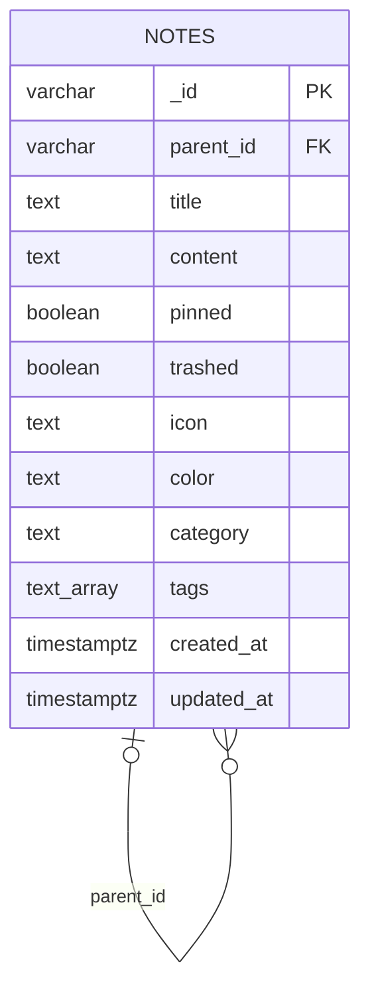
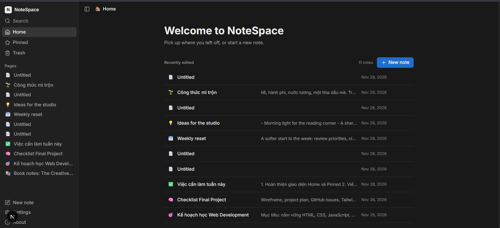
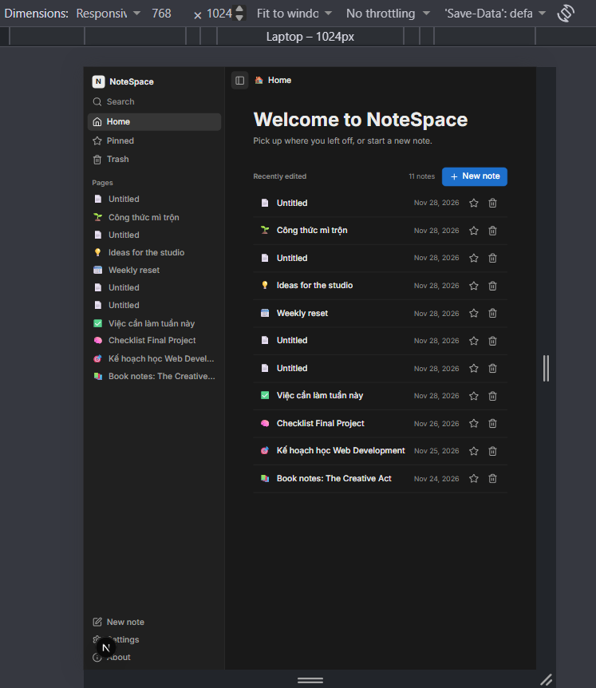
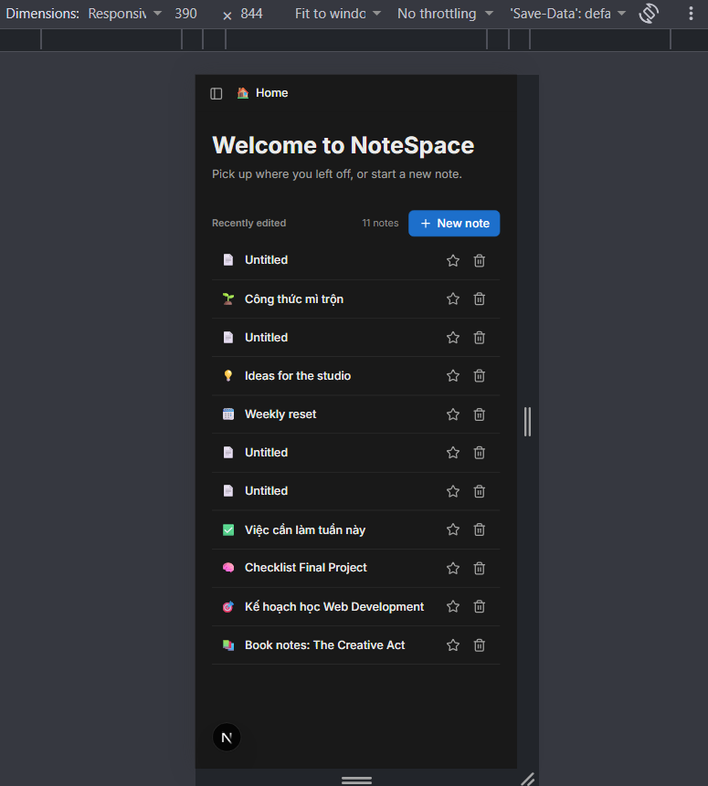

# NoteSpace

NoteSpace là ứng dụng ghi chú của Nhóm 5, lớp Basic 2, học phần **CSB25022 – Web Design and Development**. Người dùng có thể tạo, tìm kiếm, ghim và khôi phục ghi chú, hoặc xem trước gợi ý từ trợ lý Gemini.

- [Mã nguồn và lịch sử dự án](https://github.com/CauDravan/basic-web-note)
- [Video demo Next.js do thành viên nhóm quay](docs/evidence/notespace-demo.mp4)
- [Kết quả kiểm thử](docs/testing.md)

## 1. Công nghệ và thiết kế

| Thành phần | Công nghệ |
| --- | --- |
| Frontend | Next.js 16 App Router, React 19, Tailwind CSS 3, Lucide, Inter |
| Backend | Node.js, Express, REST API |
| Cơ sở dữ liệu | PostgreSQL qua `pg` |
| Trợ lý AI | Gemini API ở backend |
| Hosting | Vercel với hai project riêng cho frontend và backend |
| Theo dõi | Google Analytics 4 và Sentry trên bản triển khai |
| Quản lý công việc | GitHub Issues, nhánh tính năng, Pull Requests và GitHub Actions |

Bản [wireframe ban đầu](docs/wireframe.pdf) và [prototype HTML](docs/prototype.html) mô tả luồng thiết kế gốc. [Wireframe bổ sung](docs/wireframe-nextjs.html) gồm Pinned, Trash, Settings và About. Mở file HTML trong trình duyệt để đối chiếu bố cục. Mã HTML/CSS trong file là nguồn chỉnh sửa.

## 2. Tính năng và trang

| Đường dẫn | Tính năng |
| --- | --- |
| `/` | Danh sách ghi chú đang hoạt động, tìm kiếm theo tiêu đề, nội dung hoặc tag, tạo mới |
| `/notes/[id]` | Mở một ghi chú từ API, tự động lưu, ghim, đổi icon, chỉnh tag, xem trước gợi ý AI |
| `/pinned` | Danh sách ghi chú đã ghim, bỏ ghim |
| `/trash` | Danh sách ghi chú trong thùng rác, khôi phục hoặc xác nhận xóa vĩnh viễn |
| `/settings` | Lưu theme sáng/tối trong trình duyệt, kiểm tra kết nối API |
| `/about` | Giới thiệu dự án, nhóm thực hiện và liên kết mã nguồn |

Home, Pinned, Trash và trình soạn ghi chú lấy dữ liệu từ PostgreSQL qua API. Trợ lý Gemini có ba thao tác tóm tắt, cải thiện văn phong và gợi ý tiêu đề. Người dùng có thể xem trước, áp dụng hoặc bỏ kết quả.

## 3. Lược đồ cơ sở dữ liệu

Lược đồ có một bảng `notes`. Trường `parent_id` là khóa ngoại tùy chọn trỏ tới một ghi chú trong cùng bảng. Khi xóa vĩnh viễn một ghi chú cha, PostgreSQL đặt `parent_id` của ghi chú con về `NULL`. API giữ ID 24 ký tự để URL của ghi chú đã nhập từ MongoDB tiếp tục hoạt động.



- [SQL khởi tạo](backend/db/schema.sql)
- [Mã DBML để mở trên dbdiagram.io](docs/erd.dbml)

Giao diện hiển thị ghi chú dạng phẳng. Quan hệ trang cha và trang con hiện được lưu ở tầng dữ liệu.

## 4. Chạy ứng dụng

Chuẩn bị Node.js 24 và một cơ sở dữ liệu PostgreSQL cho NoteSpace.

### Backend

Tạo `backend/.env` từ [mẫu biến môi trường](backend/.env.example), điền `DATABASE_URL` và thêm `GEMINI_API_KEY` để dùng trợ lý AI. Backend dùng cổng 5000 mặc định.

```bash
cd backend
npm ci
npm run db:init
npm run seed
npm run dev
```

Seeder thêm 8 ghi chú khi bảng trống. Cấu hình `DATABASE_URL` trong môi trường thử nghiệm trước khi dùng `npm run seed -- --reset` vì lệnh đó xóa toàn bộ ghi chú hiện có trong cơ sở dữ liệu đã cấu hình.

Nếu cần giữ dữ liệu của bản MongoDB, chạy `npm run db:init`, đặt `MONGO_URI` vào `backend/.env` rồi chạy `npm run db:migrate-mongo` trước khi seed. Công cụ đọc collection `notes`, giữ ID, nội dung, tag, ngày tạo và ngày cập nhật, rồi nối lại các quan hệ cha còn tồn tại. Lần chạy sau bỏ qua ID đã có ở PostgreSQL. Trước khi chuyển bản triển khai, tạm dừng ghi trên MongoDB và đối chiếu số bản ghi. Gỡ `MONGO_URI` khỏi cấu hình sau khi chuyển dữ liệu.

### Frontend

Tạo `frontend/.env.local` với dòng dưới đây.

```dotenv
NEXT_PUBLIC_API_BASE=http://localhost:5000/api
```

```bash
cd frontend
npm ci
npm run dev
```

Mở `http://localhost:3000`. Để chạy chế độ production cục bộ, dùng `npm run build` và `npm start`. Next.js đọc `NEXT_PUBLIC_API_BASE` khi build.

### Triển khai

Đặt Root Directory của hai project Vercel tương ứng là `backend/` và `frontend/`. Khởi tạo lược đồ trên PostgreSQL dùng cho production trước khi triển khai backend. Đặt `DATABASE_URL` và `GEMINI_API_KEY` ở backend, đặt `NEXT_PUBLIC_API_BASE` ở frontend trỏ tới hậu tố `/api` trên backend. Kiểm tra `GET /api/test` và mở Home, Pinned, Trash sau khi triển khai.

Lưu biến môi trường và khóa trên máy hoặc nền tảng triển khai. Đổi hoặc thu hồi mật khẩu MongoDB từng xuất hiện trong lịch sử Git ở trang quản trị cơ sở dữ liệu cũ.

## 5. Cấu trúc dự án

```text
backend/
  api/                 Entry point cho Vercel
  config/              Kết nối PostgreSQL
  controllers/         Xử lý yêu cầu API
  db/                  Lược đồ, khởi tạo và nhập dữ liệu cũ
  models/              Lớp truy cập bảng notes
  routes/              Đường dẫn REST API
  seeds/               Dữ liệu mẫu
  services/            Tích hợp Gemini
  test/                Kiểm thử API với PostgreSQL
frontend/
  app/                 Các trang Next.js và CSS dùng chung
  components/          Sidebar, danh sách, trình soạn thảo và Settings
  lib/                 API client và hàm dùng chung
docs/                  Wireframe, ERD, ảnh, báo cáo và video demo
```

## 6. Kiểm thử, tối ưu và theo dõi

[Kết quả kiểm thử](docs/testing.md) ghi thao tác, kết quả mong đợi, kết quả thực tế và môi trường chạy. [GitHub Actions](.github/workflows/checks.yml) chạy kiểm thử API với dịch vụ PostgreSQL và build frontend khi có Pull Request hoặc thay đổi trên `main`.

### Responsive

| Desktop | Tablet 768 × 1024 | Mobile 390 × 844 |
| --- | --- | --- |
| <a href="docs/screenshots/nextjs/home-desktop.png"></a> | <a href="docs/screenshots/nextjs/home-tablet.png"></a> | <a href="docs/screenshots/nextjs/home-mobile.png"></a> |

Ảnh bổ sung gồm [sidebar mở trên mobile](docs/screenshots/nextjs/sidebar-mobile.png) và [trình soạn ghi chú trên mobile](docs/screenshots/nextjs/editor-mobile.png).

### Lighthouse

Điểm và báo cáo từng trang được ghi trong [kết quả đo Lighthouse](docs/testing.md#lighthouse).

Bằng chứng theo dõi của bản triển khai trước gồm [Google Analytics Realtime](docs/ga-realtime.jpg) và [lỗi được ghi nhận trên Sentry](docs/sentry-issue.jpg). Hai công cụ được khởi tạo trong `frontend/components/Monitoring.js` trên bản triển khai.

## 7. API

| HTTP | Đường dẫn | Mục đích |
| --- | --- | --- |
| GET | `/api/test` | Kiểm tra kết nối và lược đồ PostgreSQL |
| GET | `/api/notes` | Lấy danh sách theo lần cập nhật gần nhất |
| GET | `/api/notes/:id` | Lấy ghi chú theo ID |
| POST | `/api/notes` | Tạo ghi chú |
| PUT | `/api/notes/:id` | Cập nhật nội dung, tag hoặc trạng thái |
| DELETE | `/api/notes/:id` | Xóa vĩnh viễn ghi chú |
| POST | `/api/ai` | Nhận `action` (`summarize`, `improve`, `title`) và `text` |

## 8. Quy trình Git

1. Tạo issue, ghi tiêu chí hoàn thành, giao assignee, đặt nhãn và milestone.
2. Tạo nhánh `feature/<ten>` hoặc `fix/<ten>` từ `main`.
3. Ghi commit ngắn và có số issue, chẳng hạn `feat(frontend): add About page (#n)`.
4. Mở PR theo [mẫu](.github/pull_request_template.md), điền `Closes #n`, kết quả kiểm thử và mời một thành viên review trước khi merge.

## 9. Mốc dự án

| Mốc | Nội dung | Ngày ghi nhận hoặc mục tiêu | Trạng thái |
| --- | --- | --- | --- |
| M1 | Backend ghi chú và triển khai Vercel | 09–10/11/2026 | Đã thực hiện |
| M2 | Home, Pinned, Trash, trình soạn và Settings | 10–15/11/2026 | Đã thực hiện |
| M3 | Gemini, wireframe, ERD và dữ liệu mẫu | 15–18/11/2026 | Đã thực hiện |
| M4 | Lighthouse, Analytics và Sentry bản cũ | 17–18/11/2026 | Đã thực hiện |
| M5 | Chuyển frontend sang Next.js | 27/11/2026 | Đã merge ở `b465afc` |
| M6 | About, PostgreSQL, kiểm thử và bằng chứng Next.js | 28/11/2026 | Có trong nhánh sửa |
| M7 | Góp ý hai nhóm và phản hồi cho NoteSpace | Đề xuất trước hạn nộp 1 ngày | Chờ trao đổi |
| M8 | Rà soát bản triển khai, tự quay video demo và nộp bài | Theo hạn giảng viên công bố | Đã quay video, còn rà soát và nộp bài |

## 10. Phân công thành viên

| Thành viên | Công việc đã ghi nhận |
| --- | --- |
| Đặng Vĩnh Quang | Backend, frontend, Gemini, triển khai, seeder, ERD và README |
| Lê Tôn Hải | Wireframe ban đầu |
| Nguyễn Hữu Nhật | Chờ bổ sung liên kết cho phần việc đã được giao |
| Nguyễn Trọng Tiến | Chờ bổ sung liên kết cho phần việc đã được giao |

[Phương án phân công và mẫu biên bản](docs/teamwork.md) dùng để ghi người dự họp, hạn hoàn thành, kết quả duyệt wireframe và lược đồ, cùng đường dẫn issue hoặc PR.

## 11. Peer review UI/UX

Task 5 gồm góp ý bằng văn bản cho **hai nhóm khác** và xử lý góp ý của nhóm khác dành cho NoteSpace.

### Góp ý đã gửi

| Nhóm | Trang và thao tác đã thử | Quan sát, ảnh hưởng và đề xuất | Link issue hoặc phản hồi |
| --- | --- | --- | --- |
| Nhóm thứ nhất | Chờ link dự án | Chờ review | |
| Nhóm thứ hai | Chờ link dự án | Chờ review | |

Mỗi góp ý nên ghi rõ tên trang, kích thước màn hình hoặc thiết bị, các bước thao tác, hành vi quan sát được, ảnh hưởng đến người dùng và cách sửa đề xuất. Kèm ảnh nếu giúp nhóm nhận tái hiện vấn đề.

### Góp ý nhận được và cách xử lý

| Nguồn góp ý | Nội dung | Quyết định và lý do | Thay đổi và bằng chứng |
| --- | --- | --- | --- |
| Chờ phản hồi của nhóm khác | | | |

Khi triển khai một góp ý, ghi liên kết PR và kết quả kiểm thử sau khi sửa. Nếu góp ý được ghi dưới dạng issue trong repo NoteSpace, PR có thể dùng `Closes #n` để nối với issue.

## 12. Nhật ký phát triển

| Ngày | Công việc |
| --- | --- |
| 09/11/2026 | Kết nối cơ sở dữ liệu ban đầu, thêm API quản lý ghi chú |
| 10–18/11/2026 | Xây dựng giao diện, tích hợp Gemini, làm wireframe, nạp dữ liệu mẫu và bổ sung công cụ theo dõi |
| 27/11/2026 | Merge frontend Next.js qua [PR #29](https://github.com/CauDravan/basic-web-note/pull/29) và [PR #30](https://github.com/CauDravan/basic-web-note/pull/30) |
| 28/11/2026 | Cập nhật theo chấm thử với About, PostgreSQL, ERD, kiểm thử và báo cáo Next.js |
